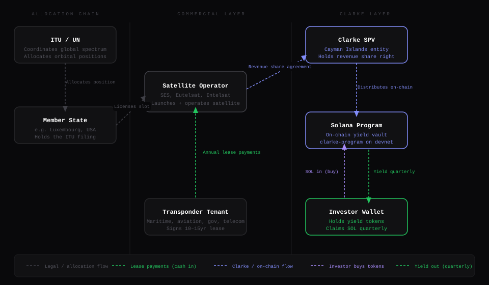

# Clarke

> **Under construction.** This project is actively being developed and is not production-ready.

**The data and intelligence layer for orbital infrastructure.**

Clarke normalizes public data across GEO, LEO, and MEO to build the orbital asset registry, pricing intelligence, and coordination layer the space economy is missing.

---



## What it is

- **Orbital registry** - a searchable, filterable, exportable explorer over every tracked GEO position, built from FCC, Space-Track, and UCS public data. ITU filings are not in this product. ITU Space Explorer is the current ITU source. SNS Online shut down in January 2025.
- **GEO Slot Index** — `/index` (alias `/research`): method-note occupancy enter/leave, dispute flips, FCC deltas. Not a price index.
- **Intelligence layer** — valuation model v0 (range + confidence + driver breakdown + 30-day history), a normalized 0–100 congestion / coordination-risk score, and per-source data-freshness tracking
- **Terminal seats** — free thin registry; Pro unlocks driver breakdown, compare (up to 4), export+, and the Terminal API
- **Data quality** — occupancy clusters on Space-Track TLE longitude when the TLE passes published quality gates (UCS catalog longitude is kept and shown). Disagreements >2° are flagged. TLE longitude is not an FCC or ITU assignment.
- **Agent access** — a versioned read-only HTTP API (public agents + Pro Terminal) and an MCP server expose the registry to LLM agents and tools
- **Blog** — long-form writing on orbital infrastructure, space compute, and the space economy
- **About** — what Clarke is, why now, data sources, registry methodology, and data quality notes, all on one page

---

## Agents API & MCP

Clarke exposes its registry as machine-readable data for LLM agents and tools.

**HTTP API:** versioned, read-only, rate-limited, CORS-enabled, and ETag-cached. Responses are wrapped in a `{ data, meta }` envelope, where `meta.data_freshness` reports when each source was last ingested. Successful agent responses set `Cache-Control: public, s-maxage=3600, stale-while-revalidate=60`.

| Endpoint | Returns |
|---|---|
| `GET /api/v1/agents/slots` | All registry rows: operatorIdentity and operatorMix, occupancy, FCC rows, disputes, source vintage (`fccStale`, `tleStale`, 14 days). Valuation and congestion live on the human Slot Terminal. |
| `GET /api/v1/agents/slots/{slug}` | One slot, same record as the list. `clarke_get_terminal` returns this same JSON. |
| `GET /api/v1/agents/satellites` | GEO satellites (filter by `operator`, `ownerCountry`, `limit`) |
| `GET /api/v1/agents/deltas` | On-ingest occupancy, FCC, and dispute changes. `coverage=bootstrap` until a second registry snapshot exists. Valuation and congestion live on the human Slot Terminal. |
| `GET /api/v1/openapi` | OpenAPI 3.1 spec for agents + Terminal routes |
| `GET /api/v1/terminal/slots` | **Pro** — Terminal summaries |
| `GET /api/v1/terminal/slots/{slug}` | **Pro** — full Terminal model (occupancy, FCC, valuation; experimental stubs included but labeled) |
| `GET /api/v1/terminal/valuations/{slug}` | **Pro** — current valuation v0 |
| `GET /api/v1/terminal/valuations/{slug}/history` | **Pro** — daily model snapshots |
| `GET /api/v1/terminal/compare?slugs=` | **Pro** — up to 4 slots |

Pro Terminal routes accept a session cookie or `Authorization: Bearer ck_live_…` / `X-Clarke-Key`. Mint a key from `/account` while signed in as Pro. Public agents API stays unauthenticated (60 req/min/IP); Pro keys get 300 req/min.

**MCP server.** The same registry as tools for Claude Code, Cursor, and other MCP clients.

Public remote endpoint (stateless Streamable HTTP, reads are open): `https://www.clarkebelt.finance/api/v1/mcp`

Local stdio:

```bash
npm run mcp
```

Tools: `clarke_list_slots`, `clarke_get_slot`, `clarke_get_terminal`, `clarke_list_deltas`, `clarke_list_satellites`. Tool text is compact JSON. `clarke_get_terminal` is the same JSON as `clarke_get_slot`. `clarke_list_deltas` is the same JSON as `GET /api/v1/agents/deltas`. `clarke_list_satellites` defaults `limit` to 100. The slot record uses operatorIdentity and operatorMix, not a single headline operator. Valuation and congestion live only as labeled models on the human Slot Terminal. Field list: [`docs/AGENT_API.md`](./docs/AGENT_API.md) (public page [`/docs/agent-api`](https://clarkebelt.finance/docs/agent-api)). See the header of `scripts/clarke-mcp.ts` for a sample client config.

Public agent HTTP routes and remote MCP write one `clarke.usage` JSON line to stdout on each origin hit (Vercel Observability, and a log drain if the project has one). The line is a daily-salted IP hash, user agent, route, status, MCP tool name, and the whitelisted fields `slug`, `limit`, `view`, `all`, `since`, `offset`, and `after`. It does not include the raw IP, cookies, authorization, or the request body. MCP POST is `no-store`, so tool calls show up. Filter logs for `clarke.usage` and `"transport":"mcp"`. The line does not block clients and does not change the 60 per minute ordinary limit or the 12 per minute heavy limit. Firewall bot protection is a separate switch. Local stdio does not print this line, because stdout is the MCP transport.

---

## Data pipeline

The registry is backed by a SQLite database (`data/clarke.db`) that ships committed, so the app runs out of the box. To rebuild it from source:

```bash
npm run ingest            # UCS Satellite Database (GEO subset)
npm run ingest:fcc        # FCC Approved Space Station List (from data/ssal.xlsx; see docs/FCC_REFRESH.md)
npm run vintages          # record UCS / FCC / TLE file vintages without a full re-download
npm run ingest:spacetrack # Space-Track satcat + TLEs (requires credentials)
npm run ingest:all        # all of the above
```

Each run records its timestamp, row count, and **source vintage** (UCS latest GEO launch, FCC workbook as-of, TLE epoch range) in `ingest_meta`, surfaced on Slot Terminal, `/about`, and the API's `meta.data_freshness`. Ingest `last_run` is not file vintage. FCC, UCS, and Space-Track ingests also append a `registry_snapshots` row when occupancy membership, dispute records, FCC call signs, parsed `data/ssal.xlsx` filings, or those file vintages change. When two snapshots both store those workbook rows, `GET /api/v1/agents/deltas` reports new, removed, and changed filings. `GET /api/v1/agents/deltas` diffs those rows. `npm run snapshot:registry` records the current state when you need the baseline without a full ingest. Space-Track ingest stores satcat + TLEs and applies **TLE-primary occupancy authority**: UCS `longitude_geo` is preserved (wrap-normalized only); occupancy, congestion, and valuation v0 cluster on the TLE sub-satellite longitude when age/quality gates pass, otherwise UCS, with Δ / `positionDisputed` written as an audit trail. Against a DB that already has TLEs: `npm run apply:positions` then `npm run seed:valuations` (history is a labeled backfill, not trades).

---

## Stack

- **Frontend:** Next.js 16, Tailwind CSS 4, Manrope + IBM Plex Mono
- **Database:** SQLite via `better-sqlite3`
- **Agent interface:** versioned REST API + MCP server (`@modelcontextprotocol/sdk`)
- **Data:** FCC SSAL, Space-Track, UCS Satellite Database, SEC EDGAR. ITU filings are not in this product. ITU Space Explorer is the current ITU source. SNS Online shut down in January 2025.

---

## Running locally

```bash
npm install
npm run seed:valuations   # persist 30-day v0 history into data/terminal.db
npm run dev
```

Open `/orbital` for the registry, `/orbital/101w` (or `/slot/101w`) for a slot page, `/login` for a free session, `/pricing` for access.

Public methodology: [`/docs`](https://clarkebelt.finance/docs). Data trust, agent API, valuation v0, FCC SSAL refresh. Repo copies: [`docs/DATA_TRUST.md`](./docs/DATA_TRUST.md), [`docs/AGENT_API.md`](./docs/AGENT_API.md), [`docs/VALUATION.md`](./docs/VALUATION.md), [`docs/FCC_REFRESH.md`](./docs/FCC_REFRESH.md).

```bash
npm test                  # valuation v0 + TLE occupancy authority tests
```

---

## Environment variables

| Variable | Required | Description |
|---|---|---|
| `NEXT_PUBLIC_URL` | Yes (prod) | Canonical URL |
| `AUTH_SECRET` | Yes (prod) | HMAC secret for session cookies and API keys |
| `STRIPE_SECRET_KEY` | No | Stripe secret. Live billing is not wired, and `/pricing` does not call Checkout. |
| `STRIPE_PRICE_ID` | No | Stripe Price id for a Terminal seat subscription |
| `STRIPE_WEBHOOK_SECRET` | No | Reserved for Stripe webhook signature checks. `/api/billing/webhook` does not verify signatures. |
| `SPACETRACK_USERNAME` | No | Space-Track login (for `npm run ingest:spacetrack`) |
| `SPACETRACK_PASSWORD` | No | Space-Track password (for `npm run ingest:spacetrack`) |
| `PV_SECRET` | No | Legacy fallback HMAC secret when `AUTH_SECRET` is unset. The `/api/pv` beacon has been removed. |
| `NEXT_PUBLIC_PLAUSIBLE_DOMAIN` | No | Plausible analytics domain |
| `USAGE_LOG_SALT` | No | Daily salt for public agent and MCP `ipHash` logs. Falls back to `AUTH_SECRET` |

---

## License

MIT
